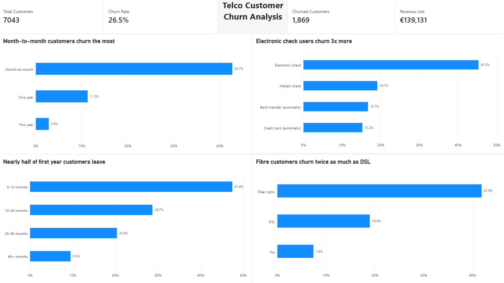

# Telco Customer Churn Analysis

**Tools:** SQL (SQLite), Power BI
**Author:** Merdi Mayindu

## Business problem

A telecom company is losing roughly 1 in 4 customers. This project uses SQL to find **who is leaving, why, and how much it costs**, then turns the findings into a Power BI dashboard and practical retention recommendations.

## Dataset

[IBM Telco Customer Churn](https://www.kaggle.com/datasets/blastchar/telco-customer-churn) (Kaggle): 7,043 customers, 21 columns covering contract type, services, billing, tenure and whether the customer churned.

## Data checks and cleaning

- Confirmed 7,043 rows with 7,043 unique customer IDs, so there are no duplicates.
- Found **11 missing `TotalCharges` values**. All 11 belong to customers with tenure = 0, meaning they are brand-new and haven't been billed yet, so the data isn't wrong. These were set to 0 rather than deleted.
- Created a clean view (`churn_clean`) that converts text columns to numbers and adds a 1/0 `churned` flag to make churn-rate calculations simple.

## Key findings

| Area | Finding |
|---|---|
| Overall | **26.5%** churn rate (1,869 of 7,043 customers) |
| Contract | Month-to-month **42.7%** vs one-year 11.3% and two-year 2.8% |
| Tenure | **47.4%** of customers in their first 12 months churn, falling to 9.5% after 4 years |
| Payment | Electronic check **45.3%**, around 3x the rate of automatic payments (15–17%) |
| Internet | Fibre optic **41.9%**, roughly double DSL (19.0%) |
| Revenue | Churned customers accounted for **€139,131** in monthly charges, about 30% of monthly revenue |

### Highest-risk group

Customers on a **month-to-month contract + fibre optic + electronic check** churn at **60.4%**. This group is under 19% of customers but accounts for **42% of all churners** (789 of 1,869).

## Recommendations

1. **Move customers onto longer contracts.** Offer a discount or free add-on for switching from month-to-month to a 12-month contract.
2. **Focus on the first year.** Introduce an early-life retention programme with check-ins at months 1, 3 and 6.
3. **Target the highest-risk group.** Encourage switching to automatic payment, and review fibre pricing and service quality.

## Dashboard

## Files

| File | Description |
|---|---|
| `churn_analysis.sql` | All SQL queries, with the business question and finding for each |
| `telco_churn_dashboard.pbix` | Power BI dashboard |
| `dashboard.png` | Dashboard screenshot |
